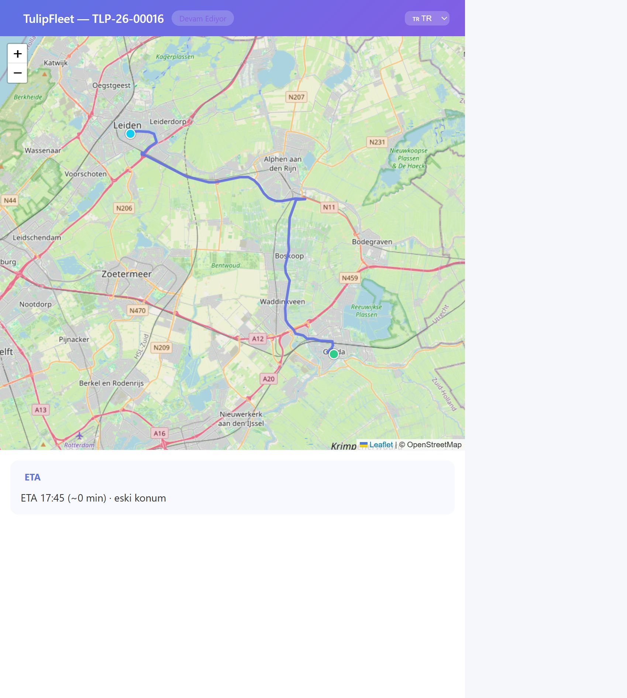

# Public track HERE road and ETA

Branch: `feat/track-here-route` from `origin/main` `0afadf2`. Code commit `6f5bd1b`.  
No merge. Prod was not touched. Date: 2026-10-07.

The public page was drawing a straight line between pickup and delivery. It now asks HERE once, stores the road on `tasks.route_json`, and reads that cache after. An in-progress task also gets an ETA. A public GET does not write `task_events`.

## Code

The decoder is the official HERE flexible-polyline reference (`javascript/index.js`), vendored under the MIT notice. No npm package was added, so this change does not need `--renew-anon-volumes` in prod. `decodeLatLng` keeps Leaflet order `[lat, lng]` and drops a third dimension.

| Item | Proof |
|---|---|
| Vendored decoder and `[lat, lng]` helper | `utils/herePolyline.js:199-207`, license `utils/herePolyline.LICENSE` |
| HERE request `return=summary,polyline,incidents`; geometry is optional | `services/routing/HereRoutingProvider.js:62`, decode `:84` |
| A bad polyline leaves `durationSec` / `delayMin` / `incidents` intact | `services/routing/HereRoutingProvider.js:80-97` |
| `RouteResult.geometry` and `distanceM` are optional | `services/routing/contract.js:39-40` |
| Driver traffic callers still use `buildTrafficPayload` only | `server.js:5862`, `server.js:6042` |
| The existing provider instance is the one the public route uses | `server.js:5724` |
| In-flight promise map, one HERE call per task, one `route_json` write | `routes/publicTrack.js:195-252` |
| Persist merges `{origin, destination, geometry, distance_m, duration_s, provider:'here', computed_at}` | `routes/publicTrack.js:321-328` |
| Success is logged once per computation; the request URL is not logged | `routes/publicTrack.js:341` |
| HERE missing or failed: log once, keep the straight line, never 5xx | `routes/publicTrack.js:280-291`, fallback draw `routes/publicTrack.js:1152-1153` |
| Road polyline when `geometry.length >= 2` | `routes/publicTrack.js:1140-1150` |
| ETA cache is single-instance bounded (one Node process in one container), 60 s | `routes/publicTrack.js:195-203`, `routes/publicTrack.js:407` |
| Within 50 m: `{minutes:0, arrival_at, source:'proximity'}`, no HERE call | `routes/publicTrack.js:366-374` |
| `last_location` older than 10 minutes sets `eta.stale` | `routes/publicTrack.js:204`, `routes/publicTrack.js:349-354` |
| HERE ETA shape `{minutes, arrival_at, source:'here'}` for `in_progress` only | `routes/publicTrack.js:405`, `routes/publicTrack.js:519-524` |
| HTML `ETA HH:MM (~N min)` | `routes/publicTrack.js:1092` |
| `STOP_DELAYED` insert removed from the public read | no `task_events` insert remains in `routes/publicTrack.js`. Driver and dispatcher logic stays at `server.js:1952`, `:1962`, `:1969`, `:1979`, `:2147`, `:2158` |

## Not in this branch

`simulate_fleet.js` still moves along a straight leg from pickup to dropoff (`simulate_fleet.js:157-163`). It does not follow `tasks.route_json.geometry`. That belongs on a separate branch.

## Tests

`npm test`: 24 passed, 0 failed.

`tests/herePolyline.test.js` decodes the HERE sample `BFoz5xJ67i1B1B7PzIhaxL7Y` to four `[lat, lng]` pairs. `tests/hereRoutingProvider.test.js` checks `return=summary,polyline,incidents`, optional geometry, and an unchanged traffic payload. `tests/publicTrackHere.test.js` checks that the second read makes no HERE call, that concurrent first visits share one call, that ETA is null unless `in_progress`, that 50 m returns `source:'proximity'` with no HERE call, that a location older than 10 minutes sets `stale`, and that a public GET does not insert `task_events`.

## Staging

Checkout of `origin/feat/track-here-route` on `/opt/fleet/backend-staging`, not a file copy. Detached HEAD `6f5bd1b`. `node --check` passed for `routes/publicTrack.js`, `services/routing/HereRoutingProvider.js`, and `utils/herePolyline.js`. PM2 `fleet-staging` restarted (`--update-env`), pid `2667217`, `/health` 200. `fleet-sim-prod` stayed pid `2696796`. HERE was configured; the key was not printed.

Proof task `TLP-26-00016`, `status=in_progress`, no `route_json.geometry` before the first read, enterprise pickup and dropoff present, a location row present. The proof token was revoked (`revoked=1`). `STOP_DELAYED` rows in the 15 minutes around the reads: 0 before, 0 after.

First `GET /v/<token>.json` against `127.0.0.1:3001`:

```
HTTP/1.1 200 OK
content-type: application/json; charset=utf-8
x-robots-tag: noindex, nofollow
cache-control: no-store
referrer-policy: no-referrer
```

`route.geometry` length 693. `route.origin` / `route.destination` keys are `label,lat,lng`. `last_location` present. `eta` is `{minutes:0, source:'proximity', stale:true}` with `arrival_at` set. No `id` / `*_id` keys. The pm2 log gained one `public track HERE route computed` line and no `public track HERE route unavailable` line.

Second JSON read: geometry length still 693, same ETA shape, and the HERE route log did not increase.

HTML: `200`, `content-type: text/html; charset=utf-8`, `referrer-policy: strict-origin-when-cross-origin`, `x-robots-tag` and `cache-control` unchanged.

The last location is within 50 m of the destination and older than 10 minutes, so the page short-circuits to proximity and marks the ETA stale. The browser showed the road polyline, the origin dot, the destination dot with the vehicle marker stacked on it, and `ETA 17:45 (~0 min) · eski konum`. DOM: 2 stop markers, 1 `vehicle-marker`, 1 polyline (47 path commands at that zoom, not a 2-point line), 35 OSM tiles, none blocked. The bus glyph is an `ion-icon` and this page does not load ionicons, so the stacked marker is the visible vehicle position.


