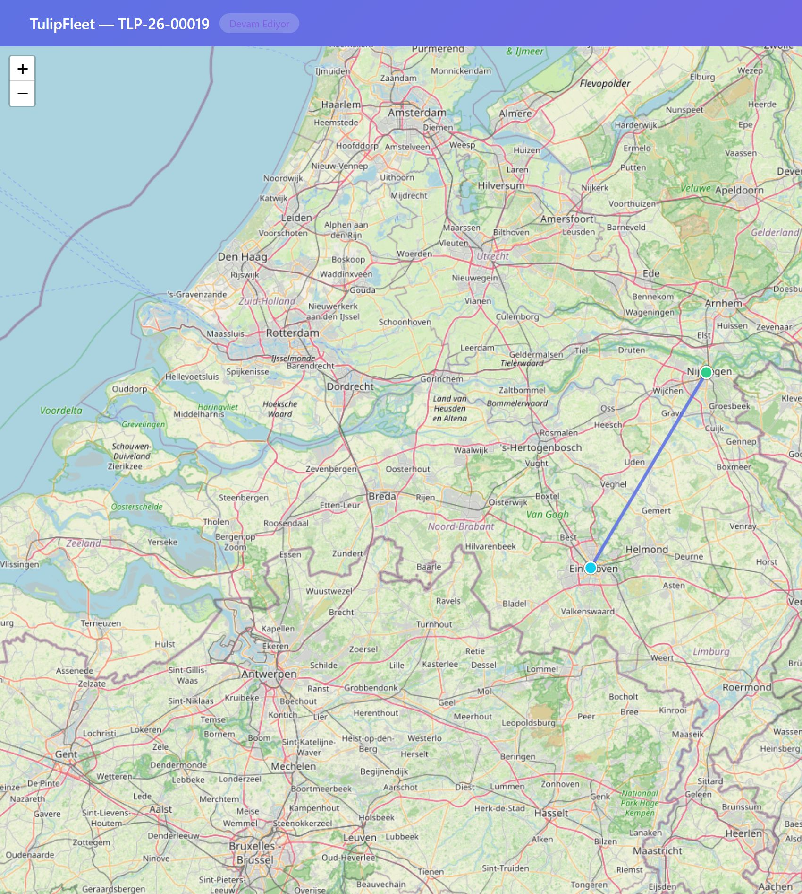

# Public track route fallback

Branch: `fix/track-route-fallback` from `origin/main` `61ccd1e`.  
No merge. Prod was not touched. Date: 2026-10-07.

A dispatcher-created core task has `tasks.route_json` NULL. Its coordinates live on `enterprise.dispatch_tasks.pickup_location` / `dropoff_location` as `{lat,lng,address}`, linked by `tasks.enterprise_dispatch_task_id`. The public page only plotted `waypoints`, so those tasks drew nothing useful. Truthy but non-numeric coordinates became markers at (0,0), the circles at sea.

## Code

Resolution matches `simulate_fleet.js` `numPair` (`simulate_fleet.js:90-93`) and the origin/destination choice (`simulate_fleet.js:124-125`): `route_json.origin` / `route_json.destination` first, otherwise the enterprise pickup / dropoff.

| Item | Proof |
|---|---|
| `numPair` reads `lat`/`lng` or `latitude`/`longitude`, and drops (0,0) | `routes/publicTrack.js:175-182` |
| `resolveRoutePoint` prefers the route_json point, else the enterprise point. Public shape is `{lat,lng,label}` | `routes/publicTrack.js:184-197` |
| Label is `label`, else `address`, else `name`, else the core location string. No ids | `routes/publicTrack.js:190-196` |
| SQL joins `enterprise.dispatch_tasks` on `tasks.enterprise_dispatch_task_id` | `routes/publicTrack.js:316-321` |
| JSON `route.origin` / `route.destination` | `routes/publicTrack.js:360-372`, sent at `:495` |
| Pickup and delivery markers | `stop-marker stop-origin` / `stop-destination` `routes/publicTrack.js:1054-1056`, drawn `:1079-1085` |
| Straight polyline between them. HERE polyline stays MVP-2 | `routes/publicTrack.js:1087-1088` |
| `fitBounds` uses origin, destination, the vehicle point, and only usable waypoints | `routes/publicTrack.js:1076-1124` |
| Vehicle marker only from a usable `last_location`, and `last_location` is still limited to `in_progress` | `routes/publicTrack.js:1103-1114` |
| Waypoint circles use the same usable-point check, so (0,0) and undefined are not drawn | `routes/publicTrack.js:1045-1051`, `:1091-1093` |
| Hardening headers unchanged | HTML `strict-origin-when-cross-origin`, JSON `no-referrer`, `X-Robots-Tag` and `Cache-Control` still set in the `onRequest` hook |

## Tests

`npm test`: 16 passed, 0 failed (10 public-track, 6 reports).

`tests/publicTrack.test.js:270` loads a task with `route_json` null and enterprise pickup/dropoff. JSON `route.origin` / `route.destination` are `{lat,lng,label}` (`:279-288`). No `id` / `*_id` keys. The HTML contains `stop-marker stop-origin` and `stop-marker stop-destination` (`:295-296`) and `L.polyline([origin, dest]`.

## Staging

Checkout of this branch on `/opt/fleet/backend-staging`, not a file copy. HEAD `571e49a`. The previous uncommitted `routes/publicTrack.js` (the earlier tile-referrer file copy) was replaced by that checkout. PM2 `fleet-staging` restarted (pid `2630978`). `fleet-sim-prod` was not restarted. `node --check routes/publicTrack.js` passed.

Proof task `TLP-26-00019`, `status=in_progress`, `route_json` null, enterprise pickup and dropoff present, a location row present. The proof token was revoked (`revoked=1`). No `STOP_DELAYED` row was created.

`curl -i` `https://staging-api.tulipfleet.com/v/<token>.json`:

```
HTTP/1.1 200 OK
Content-Type: application/json; charset=utf-8
x-robots-tag: noindex, nofollow
cache-control: no-store
referrer-policy: no-referrer
```

`route.origin` and `route.destination` keys are `label,lat,lng`. Both coordinates are finite and not (0,0). Both labels are non-empty. `last_location` keys are `heading,latitude,longitude,speed,time`. `idKeys` empty. `task.status=in_progress`.

HTML response: `HTTP/1.1 200 OK`, `referrer-policy: strict-origin-when-cross-origin`.

In the browser the page title is `TulipFleet — TLP-26-00019`. The DOM has two stop markers (`stop-origin`, `stop-destination`), one `vehicle-marker`, and one polyline. 35 OSM tiles decoded. No "Access blocked".


