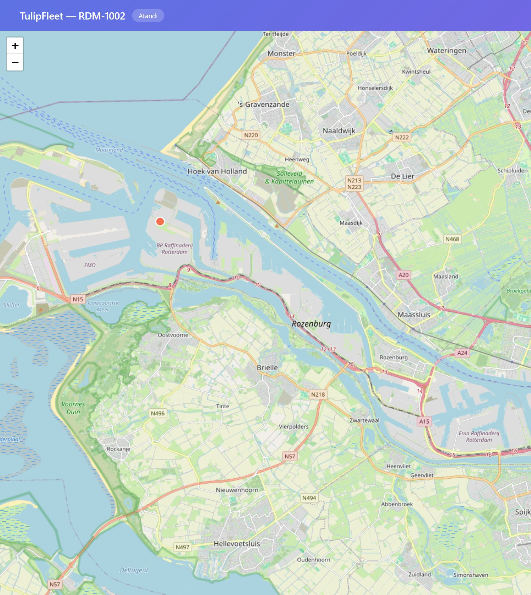

# Track tile referrer

Branch: `fix/track-tile-referrer` from `origin/main` `b8abbe5`.  
No merge. Prod was not touched. Date: 2026-10-07.

OSM returns 403 `Access blocked` when the tile request has no `Referer`. Hardening had set `Referrer-Policy: no-referrer` on the HTML page, the meta tag, and the Leaflet tile layer. The token path must still not be sent to the tile CDN.

## Code

| Item | Proof |
|---|---|
| HTML routes: `Referrer-Policy: strict-origin-when-cross-origin` | `publicReferrerPolicy` `routes/publicTrack.js:1056-1060`, hook `:1064-1067` |
| `.json` routes: `Referrer-Policy: no-referrer` | same function, path ending in `.json` |
| `X-Robots-Tag: noindex, nofollow` and `Cache-Control: no-store` unchanged | `routes/publicTrack.js:1065-1066` |
| `<meta name="referrer" content="strict-origin-when-cross-origin">` | 404 shell `routes/publicTrack.js:53`; success page `:815` |
| Leaflet `referrerPolicy: 'strict-origin'` | `routes/publicTrack.js:909` |

`strict-origin` on the tile image sends `Referer` as the origin only (`https://<host>/`), including the trailing slash, and not `/v/<token>`.

## Tests

`npm test` (`node --test "tests/**/*.test.js"`): 15 passed, 0 failed (9 public-track, 6 reports).

HTML responses assert `strict-origin-when-cross-origin` (`tests/publicTrack.test.js:205`, `:276`, `:292`, `:300`). JSON responses assert `no-referrer` (`:40`, `:206`, `:277`). The success page asserts the meta value (`:201`) and `referrerPolicy: 'strict-origin'` (`:203`).

## Staging

Host `fleet-prod-01`, app `/opt/fleet/backend-staging`, PM2 `fleet-staging` only (pid `2567052`). `fleet-sim-prod` was not restarted. Backup: `routes/publicTrack.js.bak.20261007_155854`. `node --check` passed. The proof token was revoked (`revoked=1`).

`curl -i` to `127.0.0.1:3001` and `https://staging-api.tulipfleet.com` for assigned task `RDM-1002`:

| Response | Status | referrer-policy | Other headers |
|---|---|---|---|
| `/v/:token` HTML | `HTTP/1.1 200 OK` | `strict-origin-when-cross-origin` | `content-type: text/html; charset=utf-8`; `x-robots-tag: noindex, nofollow`; `cache-control: no-store` |
| `/v/:token.json` | `HTTP/1.1 200 OK` | `no-referrer` | `content-type: application/json; charset=utf-8`; same robots and cache headers |

HTML body: `<title>TulipFleet — RDM-1002</title>`, meta `strict-origin-when-cross-origin`, tile option `strict-origin`. The old `no-referrer` meta and tile option are absent.

Browser on `https://staging-api.tulipfleet.com/v/<token>` (this browser has no DevTools panel; the Network facts are from the page and from nginx):

- Title `TulipFleet — RDM-1002`. Map tiles are drawn (screenshot `docs/screenshots/track-tile-referrer/map-staging.jpg`). Page text does not contain `Access blocked`.
- 35 `img.leaflet-tile` elements, each `naturalWidth` 256, hosts `a.tile.openstreetmap.org`, `b.tile.openstreetmap.org`, `c.tile.openstreetmap.org`. Every tile image `referrerPolicy` is `strict-origin`. The page meta is `strict-origin-when-cross-origin`.
- An image request from that same document, with `referrerPolicy` set to `strict-origin` (the Leaflet option), was logged by nginx. The `Referer` field is `https://staging-api.tulipfleet.com/`. The log line does not contain `/v/`.

